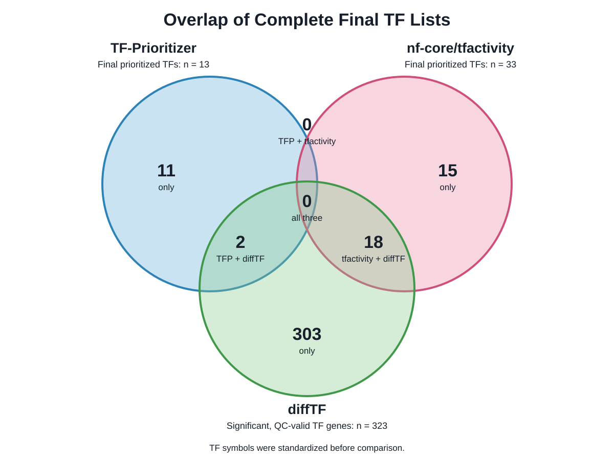
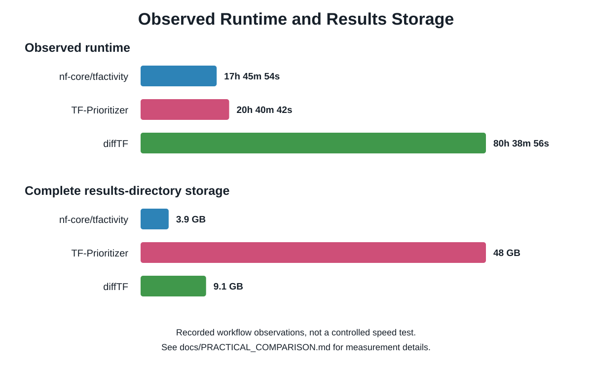

# Georgetown Internship Project 2026: Benchmarking Transcription Factor Activity Pipelines

This repository contains the scripts, configurations, documentation, summarized results, and final presentation from a benchmark of three transcription factor (TF) activity pipelines:

- **TF-Prioritizer**
- **nf-core/tfactivity**
- **diffTF**

The pipelines were applied to ENCODE data from K562 and MCF7 cells to determine how consistently they identify TFs associated with differences between the two cell types. Their runtime, storage use, outputs, portability, and recovery from interrupted runs were also compared.

## Biological question

How consistently do nf-core/tfactivity, TF-Prioritizer, and diffTF prioritize transcription factors that distinguish K562 and MCF7 cells?

The comparison addressed two main questions:

1. How much agreement is there among the pipelines' TF predictions?
2. How do the pipelines differ in their practical performance and usability?

## Input data

The benchmark used public ENCODE data:

| Input | K562 | MCF7 | Total |
|---|---:|---:|---:|
| DNase-seq peak files | 5 | 5 | 10 |
| DNase-seq BAM alignments | 5 | 5 | 10 |
| RNA-seq gene quantifications | 14 | 4 | 18 |

The selected DNase-seq files used the GRCh38 human genome assembly.

The complete accession list and ENCODE download links are available in [`data_manifest/encode_input_manifest.tsv`](data_manifest/encode_input_manifest.tsv).

## Pipeline approaches

| Pipeline | Main approach | Inputs used |
|---|---|---|
| **TF-Prioritizer** | Uses HINT, TEPIC, and DYNAMITE to connect predicted TF binding with gene-expression differences | DNase-seq peaks, BAM alignments, and RNA-seq counts |
| **nf-core/tfactivity** | Uses STARE and DYNAMITE in a modular Nextflow workflow | DNase-seq peaks and RNA-seq counts |
| **diffTF** | Measures differential chromatin accessibility around predicted TF-binding sites | DNase-seq peaks and BAM alignments |

diffTF was run in basic mode without RNA-seq.

## Key biological results

The complete final TF lists differed substantially:

| Comparison | Shared TFs |
|---|---:|
| TF-Prioritizer and nf-core/tfactivity only | 0 |
| TF-Prioritizer and diffTF only | 2 |
| nf-core/tfactivity and diffTF only | 18 |
| All three pipelines | 0 |

The final lists contained:

- **13 TFs** from TF-Prioritizer
- **33 TFs** from nf-core/tfactivity
- **323 significant, quality-controlled TFs** from diffTF

No TF was shared between any pair of pipelines when only the top 13 results from each method were compared. The larger complete-list overlap between nf-core/tfactivity and diffTF indicates greater agreement between those two analyses, but overlap alone does not establish that one pipeline is more accurate.



## Practical comparison

| Pipeline | Recorded runtime | Results storage | Main output |
|---|---:|---:|---|
| nf-core/tfactivity | 17 h 45 min 54 s | 3.9 GB | Interactive HTML report |
| TF-Prioritizer | 20 h 40 min 42 s | 48 GB | Interactive HTML report |
| diffTF | 80 h 38 min 56 s | 9.1 GB | Tables and PDF figures |

nf-core/tfactivity had the shortest successful runtime and used the least storage. TF-Prioritizer produced the largest results directory, while diffTF took the longest and required more manual interpretation.

These values describe the completed project runs rather than a controlled performance experiment. The pipelines used different execution models and levels of parallelism, and their recorded runtimes do not include failures in exactly the same way.



More detail is provided in [`docs/PRACTICAL_COMPARISON.md`](docs/PRACTICAL_COMPARISON.md).

## Repository contents

| Directory | Contents |
|---|---|
| [`configs/`](configs/) | Pipeline configuration files |
| [`data_manifest/`](data_manifest/) | ENCODE accessions, source links, and input documentation |
| [`docs/`](docs/) | Reproducibility, software, and practical-comparison documentation |
| [`environments/`](environments/) | Software environment specifications |
| [`figures/`](figures/) | Reproducible summary figures |
| [`patches/`](patches/) | Compatibility patches required during the project |
| [`presentation/`](presentation/) | Final PowerPoint presentation with speaker notes |
| [`results/comparison_tables/`](results/comparison_tables/) | Standardized rankings, overlaps, and comparison tables |
| [`results/final_summary_files/`](results/final_summary_files/) | Native final summary outputs from each pipeline |
| [`samplesheets/`](samplesheets/) | Pipeline input organization |
| [`scripts/`](scripts/) | Data preparation, execution, comparison, and verification scripts |

## Verify the archived results

The internal consistency of the archived tables and native summary files can be checked with Python 3:

```bash
python3 scripts/comparison/verify_comparison_tables.py
python3 scripts/comparison/verify_native_summaries.py
```

The summary figures can be regenerated with:

```bash
python3 scripts/comparison/generate_summary_figures.py
```

## Reusing the workflow files

The archived scripts were written for the Expanse high-performance computing system and use the Slurm workload manager.

Before reuse:

1. Replace the path placeholders in the scripts, configurations, and sample sheets.
2. Download the required ENCODE inputs using the data manifest.
3. Install the recorded software versions.
4. Obtain the original pipeline source code at the documented revisions.
5. Review and apply the compatibility patches when appropriate.
6. Adjust the Slurm account, partition, memory, CPU, and time settings for the target system.

Detailed instructions and provenance are available in:

- [`docs/REPRODUCIBILITY.md`](docs/REPRODUCIBILITY.md)
- [`docs/SOFTWARE.md`](docs/SOFTWARE.md)
- [`patches/README.md`](patches/README.md)

## Presentation

The final internship presentation, including speaker notes, is available at:

[`presentation/nick-huynh-internship-presentation.pptx`](presentation/nick-huynh-internship-presentation.pptx)

Its integrity can be checked using [`presentation/SHA256SUMS`](presentation/SHA256SUMS).

## Data availability

Large genomic inputs, reference files, containers, workflow work directories, and complete pipeline output directories are not stored in this repository.

The public ENCODE inputs can be retrieved using the accessions and direct source links in [`data_manifest/encode_input_manifest.tsv`](data_manifest/encode_input_manifest.tsv).

## Limitations

- The benchmark examined one biological comparison: K562 versus MCF7.
- Only DNase-seq was used as the chromatin-accessibility assay.
- The pipelines use different definitions, scoring methods, and final filters, so their reported lists are not directly equivalent.
- The runtime comparison was observational rather than a controlled scaling experiment.
- Additional ATAC-seq, ChIP-seq, cell types, and biological comparisons would be needed to test whether the findings generalize.

## Main conclusion

nf-core/tfactivity provided practical improvements in runtime, storage use, workflow organization, and portability. However, it did not reproduce TF-Prioritizer's final predictions. The limited agreement among all three methods shows that TF activity predictions can depend strongly on the computational approach used.
